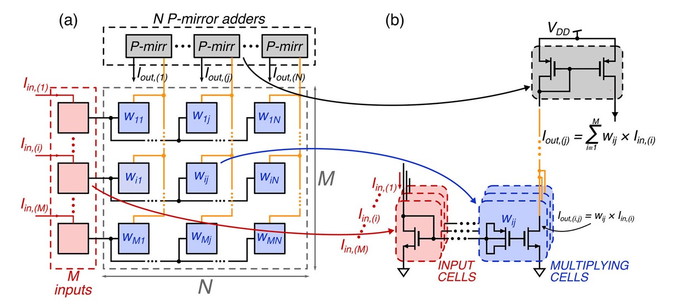
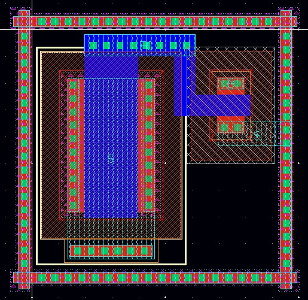
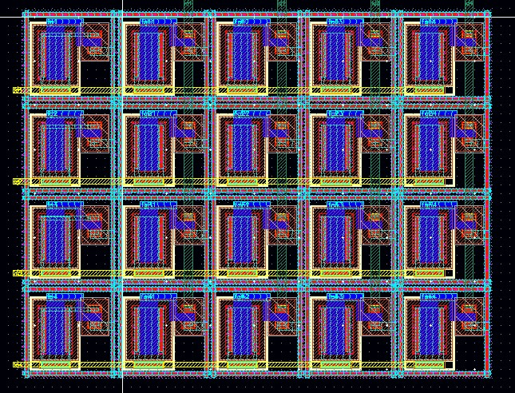
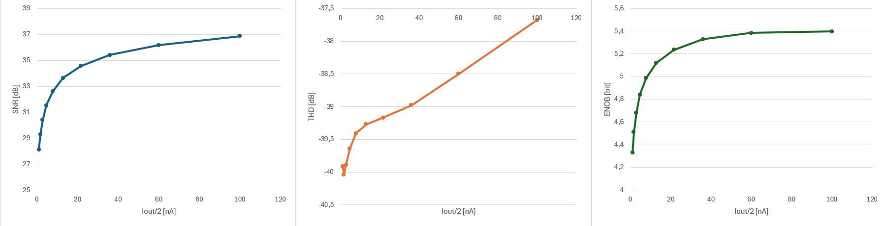
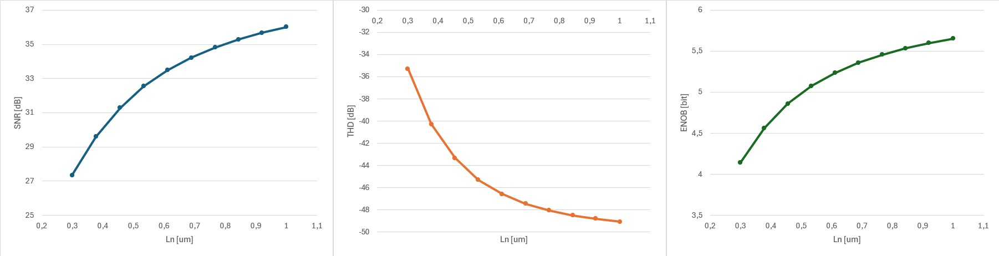

# Full-Custom Analog Vector-Matrix Multiplier (VMM) Simulations

<p align="left">
  <a href="https://www.cadence.com"></a>
  <a href="#"></a>
  <a href="./Analog%20VMM%20analysis.pdf"></a>
  <a href="./Analog%20VMM%20analysis.pptx"></a>
</p>

Academic project developed for the **University of Pisa** focusing on the full-custom design, layout, and parametric characterization of a $4 \times 4$ 
**Analog Vector-Matrix Multiplier (VMM)** operating in the **weak-inversion (sub-threshold)** regime for ultra-low-power neuromorphic compute-in-memory (CiM) applications.

---

## Architecture Overview

The VMM core relies on weak-inversion MOS floating-gate current mirrors to execute low-power analog matrix-vector multiplication.
For a single cell the output current is multiplicated by the magnification factor $w$:

$$I_{\text{out}} =  w \cdot I_{\text{in}}$$

Where $w$ is programmed by storing charge $Q_{\text{cap}}$ on a series p-cap floating gate, modifying the MOSFET threshold voltage ($V_{\text{th}}$):

$$w = \frac{I_{\text{slave}}}{I_{\text{master}}} = e^{\frac{\Delta V_{\text{th}}}{m V_t}} = e^{-\frac{Q_{\text{cap}}}{m V_t W_{\text{cap}} L_{\text{cap}} C_{\text{ox}}}}$$

<p align="center">
  
</p>

---

## Circuit & Physical Layout Design

* **Sub-Threshold Cell Operation:** All multiplying n-MOS cells are constrained to weak inversion ($I_{\text{ds}} \le 25\text{ nA}$) to guarantee exponential dynamic response and minimal power consumption.
* **Floating-Gate Cell:** Designed with $W_n/L_n = 1\mu\text{m} / 0.8\mu\text{m}$ and a series p-cap ($W_{\text{pcap}} \times L_{\text{pcap}} = 5\mu\text{m} \times 2\mu\text{m}$).
* **Full Physical Layout:** Executed full physical layout matching custom DRC/LVS design rules ($L_{\min} = 240\text{ nm}$, $W_{\min} = 340\text{ nm}$) for both single floating-gate cells and the complete $4 \times 4$ core array.

| Floating Gate Unit Cell Layout | $4 \times 4$ VMM Matrix Array Layout |
| :---: | :---: |
|  |  |

---

## Parametric Characterization & Results

Extensive Spectre transient and noise spectral analyses were conducted in **Cadence Virtuoso** to evaluate Figure of Merits (FOMs) such as **SNR**, **THD**, **SINAD**, and **ENOB**:

$$\text{ENOB} \simeq \frac{\text{SINAD} - 1.76}{6.02}$$

### 1. Dependence on Input Current Amplitude ($I_{\text{out}}$)
As input current increases, signal power grows while thermal noise floor remains constant, boosting SNR and ENOB ($>5\text{ bits}$ achieved at higher current levels).

<p align="center">
  
</p>

### 2. Dependence on Transistor Aspect Ratio ($W/L$)
Increasing channel length $L_n$ mitigates channel-length modulation effects, reducing nonlinear harmonic distortion (improving THD) and thermal noise (improving SNR), resulting in higher ENOB.

<p align="center">
  
</p>

---

## Repository Structure

```text
.
├── Analog VMM analysis.pdf         # Comprehensive project report (PDF)
├── Analog VMM analysis.pptx        # Presentation slides (PowerPoint)
├── reference_paper.pdf             # Reference IEEE literature
├── data/                           # Exported simulation datasets (.xlsx)
│   ├── ENOB_vs_Iout.xlsx
│   └── ENOB_vs_Ln.xlsx
└── img/                            # Schematics, layouts, spectrum plots, and parametric graphs
